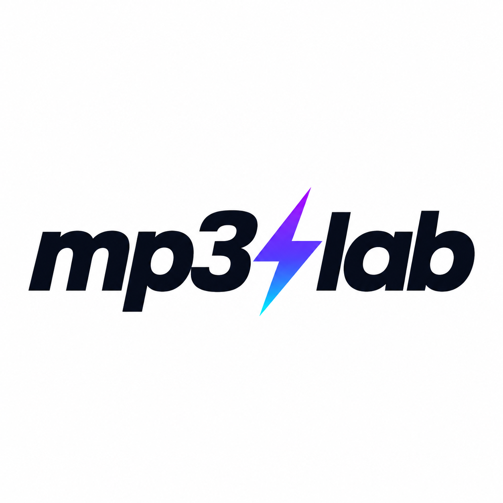

# ⚡ MP3 Lab



Free, open-source clip editor with a retro Winamp-inspired interface. MP3 Lab has a Rust desktop edition for Windows and Linux and a native Android edition.

## Download builds

**[GitHub Releases](https://github.com/gitwide-cloud/mp3-lab/releases)**

Every push to `main` starts GitHub Actions jobs for Windows, Linux and Android. A versioned `v0.2.0-preview.N` release is published **only if all three builds and required checks succeed**. Existing releases are preserved. Check [Actions](https://github.com/gitwide-cloud/mp3-lab/actions) for results. These are preview builds.

Expected files:
- `mp3-lab-setup.exe`: Windows 10/11 x64 installer, including all audio tools
- `mp3-lab-windows.zip`: self-contained portable Windows folder; extract all files and run `mp3-lab.exe`
- `windows-audio-sources.tar.gz`: corresponding sources and build recipe for bundled Windows audio tools
- `mp3-lab-linux.zip`: Linux desktop executable
- `mp3-lab.apk`: Android ARM64 debug-signed installer (Android 8+)
- `android-third-party-sources.zip`: pinned audio dependency sources and build scripts
- `SHA256SUMS.txt` and `THIRD_PARTY_NOTICES.md`

## Features

- Set clip start and end points
- Preview original or processed audio
- Fade in and fade out
- Normalize loudness to -16 LUFS
- Adjust gain -24 dB to +12 dB
- Apply a peak limiter
- Export MP3 at constant 256 kbps

## Build requirements

### Windows / Linux
```sh
cd desktop
cargo build --release
```

Published Windows downloads include `ffmpeg.exe`, `ffprobe.exe` and `ffplay.exe`; neither a separate FFmpeg installation nor a Visual C++ runtime installer is needed. The installer creates shortcuts and an uninstaller without requiring administrator rights. The portable ZIP can run from an extracted folder without installation.

For local source builds and Linux, install FFmpeg with `ffmpeg`, `ffprobe` and `ffplay` available on PATH. On Ubuntu, install `ffmpeg libxkbcommon-x11-0 libegl1 libgl1 libx11-6`. A desktop session with OpenGL support is required.

### Android
Use JDK 17, Android SDK 35, Gradle 8.9 and run:

```sh
cd android
python ../tools/prepare_android_sources.py
gradle :app:assembleDebug
```

The app uses `dev.ffmpegkit-maintained:ffmpeg-kit-audio:8.1.9` to encode audio locally. APK support is ARM64 only.

## Development status and limitations

- Rust selection/filter tests run on Windows and Linux. Linux CI also generates audio and verifies an actual 256 kbps MP3 export and trim duration.
- On November 7, 2026, the connected Pixel 7 (Android 16) passed an instrumentation test covering the real command builder, trim, fades, gain, normalization, MP3 bitrate/duration and MediaPlayer playback. Run `gradle -Pqa :app:connectedDebugAndroidTest` to repeat.
- Screenshots of the actual Linux desktop UI and Android layout are reviewed. Windows packaging tests the included tools with only Windows system directories on PATH, then silently installs the installer into a fresh folder and repeats audio tests. Manual listening and a complete file-picker/save workflow have not been fully validated.
- Android preview APKs are debug-signed. CI signing keys may change between runs; uninstall a previous preview if Android reports a signature conflict. Exported files should be backed up first.
- Both apps use the supplied metallic player reference, with real decoded audio waveforms, yellow trim handles, green displays, blue sliders and metallic controls. The mobile layout stacks panels for touch use; it is not a screenshot pasted over the app.
- Android is written in Java; the desktop apps are written in Rust.
- Android supports waveform dragging and exact time entry. Tap the clip values to enter start/end times, and tap fade/gain values for numeric entry.
- Linux desktop depends on system libraries and FFmpeg; binaries are not AppImages.
- Windows bundles an LGPL FFmpeg build. Linux uses system audio tools. Source archives and notices accompany releases.

## Licensing

Original MP3 Lab code is MIT licensed. The pinned Android audio dependency is the LGPL-3.0 audio variant; GPL codec variants are not used. APK assets include license texts, accessible through Open Source Licenses. Releases include dependency sources and rebuild instructions. Desktop ZIPs include Rust dependency notices. See [THIRD_PARTY_NOTICES.md](THIRD_PARTY_NOTICES.md). Not affiliated with Winamp.

## Contributing

Issues and pull requests welcome. Functional testing and accessibility improvements are especially valuable.
